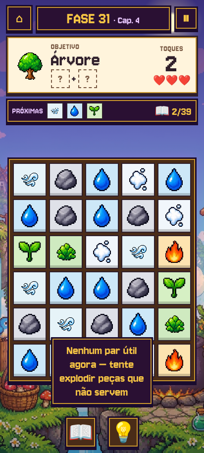
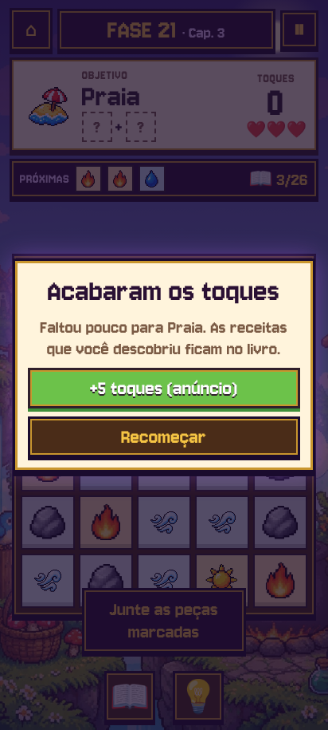
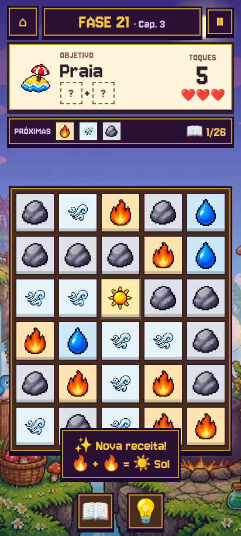
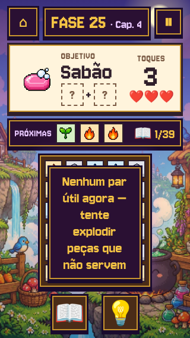
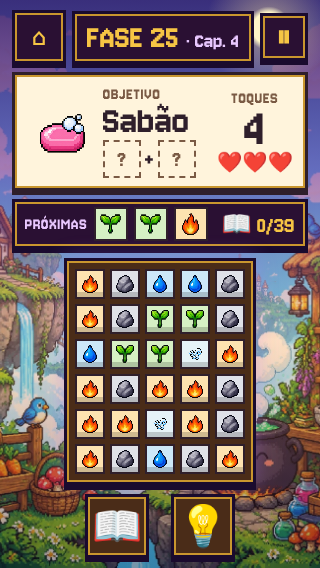

# Auditoria — capitulos-3-e-4 (2026-11-21)

**Em uma frase:** Praia e Árvore não estão apertadas por falta de toques: as
peças não se movem, então os produtos do meio precisam nascer lado a lado. Nem
quem sabe todas as receitas consegue, e a 💡 também se perde.

## Problemas (do mais grave ao menor)

### 1. Receitas longas dependem de onde as peças estão, não de saber a receita
- **O que vi:** em Praia (4 passos), Tempestade (5) e Árvore (6), os produtos
  do meio só se juntam se estiverem vizinhos. Simulei um jogador que sabe
  todas as receitas e nunca faz peça repetida. Ele perde quase sempre. Dar
  mais toques quase não ajuda.
- **Prova:** vitória desse jogador: fase 21 **10%**, fase 22 **1%**, fase 31
  **0%** (nas fases de 2 e 3 passos, 100%). Com +4 toques: 21 → 15%,
  22 → 3%, 31 → **0%**. O medidor confirma: sabeCam 19% / 0% / 0%. Na
  Árvore, a dica fez 4 Vapores, nenhum vizinho do outro, e travou com 2 toques
  
- **Sugestão:** o gerador só aceita a semente de uma fase se esse "jogador que
  sabe as receitas" vencer ≥ 50%. Se não vencer, testa a próxima semente (o
  medidor já tem quase tudo pronto). Se nenhuma semente servir para a Árvore,
  vale um teste de diversão com uma regra nova de mover peça. Não adianta
  aumentar a folga de toques.

### 2. A 💡 leva à derrota em 5 de 15 fases
- **O que vi:** a dica escolhe sempre "a peça mais avançada" sem ver o que já
  existe no tabuleiro. Ela repete produtos e, no fim, manda "explodir peças",
  mesmo quando não sobram toques para isso.
- **Prova:** medidor: dica = "não" nas fases 21, 22, 25, 29 e 31. Na fase 21,
  seguindo a 💡: Sol → Areia → Sol → **Areia de novo** → Onda → Sol → acabaram os
  toques . Na 22:
  Vapor ×5 + Raio ×2.
- **Sugestão:** a dica usa a busca do medidor e aponta uma jogada que **ainda
  vence**. Se nenhuma vencer, ela diz isso com franqueza ("daqui não fecha —
  recomece") em vez de pedir um erro. Assim a dica não vira chute.

### 3. Fase 25 (Sabão) não se vence sem errar, e a curva do capítulo 4 é uma serra
- **O que vi:** Sabão é a 3ª fase do capítulo 4 e tem **uma** jogada útil no
  início (Vida+Fogo). A Cinza nasce longe de qualquer Água, e aí a única saída é
  errar de propósito. Isso é clique à toa e custa estrela. Depois a dificuldade
  despenca e volta a subir.
- **Prova:** fase 25: soluções sem errar = **0**, sabeCam 4%. sabeCam ao longo
  do capítulo 4: 100 → 100 → **4** → 83 → 100 → 100 → 20 → 100 → **0**. Os
  alertas "FICOU MAIS FÁCIL" aparecem nas fases 26 e 30. No capítulo 3:
  100 ×4 → 19 → 0 (um penhasco no fim).
- **Sugestão:** trocar a semente do Sabão (critério do problema 1) e reordenar
  as metas do capítulo 4 pelo número medido. Também vale pôr uma meta de
  3–4 passos antes da Árvore, para a subida ser em rampa.

### 4. O jogador não tem como planejar: o objetivo é "? + ?" e não se sabe onde nasce o resultado
- **O que vi:** na primeira vez, Praia e Árvore mostram só "? + ?", mesmo
  depois de o jogador já conhecer Areia e Onda. A regra que decide tudo
  (o elemento novo nasce na **2ª peça tocada** e a 1ª recebe a próxima peça da
  fila) não aparece no "Como jogar" nem na tela. Sem isso, o problema 1 não
  dá para deduzir: vira chute.
- **Prova:** foto da fase 21 depois de fazer Sol, com o objetivo ainda em
  "? + ?" . No código, a
  ajuda só diz "nasce um elemento novo".
- **Sugestão:** (a) uma linha na ajuda e um sinal visual: a 2ª peça brilha ou
  ganha uma seta ao ser escolhida; (b) quando os dois ingredientes da meta já
  estiverem no livro, mostrá-los apagados no "? + ?" como pista. A receita
  final continua por descobrir, mas dá para deduzir.

### 5. Em tela pequena, as casas ficam minúsculas e o aviso cobre o tabuleiro
- **O que vi:** em 320×568, cada casa tem **30 px** (a especificação pede
  ≥ 48). O aviso (#toast) cobre o tabuleiro quase todo. Em 412×915, ele cobre
  a última fileira. O aviso de "Nova receita" usa emoji (🔥+🔥=☀️), não a arte
  do jogo.
- **Prova:** casas: 68 px (412), 42 px (360), 30 px (320). Aviso em 320:
  y 278–472 sobre o tabuleiro em y 258–485
  
  
- **Sugestão:** mostrar o aviso em cima do objetivo (ou na faixa "Próximas"),
  nunca sobre as casas. No celular pequeno, encolher o cabeçalho antes de
  encolher as casas. Usar as imagens dos elementos no aviso.

## O que está bom
As fases 17–20, 23, 24, 27, 28 e 30 estão saudáveis: dá para vencer sabendo as
receitas, o chute raramente vence (0–20%) e a dica funciona. O jogo já mostra
quando uma combinação dá certo ou errado (peça cresce, cai, treme, avisos "✨
Nova receita" e "💥 Não reagiu"). Nenhum erro no console.

## Relatório do amigo (conferido contra o jogo)
- **Feedback das combinações:** já existe (animações + avisos). O que falta de
  fato é o aviso não tampar o tabuleiro (problema 5).
- **Som:** não existe nenhum. A especificação diz "som opcional, tudo legível
  pela tela", então é bom ter, mas não é o que trava essas fases.
- **Livro de receitas / "18 de 60":** já existe (📖 3/26, "? + ? = ?",
  🔒 por base). A ideia de usar o livro como pista vai no problema 4.
- **Experimentos com resultado inesperado:** vai contra "regras previsíveis".
  Ranking e eventos estão fora da v1. Combos no Modo Livre ficam fora destas
  fases.

## Régua usada
Medidor: `node scripts/medir-fases.mjs --fases 17-31` (2000 partidas por
política). Alertas: CHUTE ≥ 30%, APERTADA = sabeCam < 20%, FICOU MAIS FÁCIL =
+25 pontos. Acrescentei um jogador simulado que sabe as receitas e não repete
peças (3000 partidas), porque o sabeCam também conta peças repetidas e
exagera um pouco o aperto. Mesmo assim, o resultado não muda. Joguei seguindo a 💡
no Chrome: fase 21 e 31 em 412×915 e fase 25 em 320×568.

## Depois das correções (mesmo dia)

Aplicadas as 5 sugestões: sorteio de cada fase escolhido por
`scripts/escolher-sementes.mjs` (tem solução sem errar, a 💡 vence, o chute
não resolve, dificuldade em rampa no capítulo); metas reordenadas (Mel antes
da Árvore, que virou a fase 32); a 💡 só aponta jogada que ainda vence e avisa
quando não dá mais; ajuda explica onde nasce o resultado; peça escolhida
brilha e as vizinhas ficam marcadas; pista apagada no "? + ?"; aviso no topo
com a arte dos elementos; em 320×568 as casas passaram de 30 para 50 px.
Todas as 39 fases: alertas 22 → 7; a 💡 vence em 39 de 39.

```
fase cap meta              toques mín  soluções   chute sabeCam dica  alertas
  17   3 2× raio                4    2       248    12%    100%  sim  
  18   3 2× onda                4    2       394    20%    100%  sim  
  19   3 3× poeira              5    3       200     0%     86%  sim  
  20   3 3× tornado             5    3       180     0%     86%  sim  
  21   3 praia                  6    4     10146     0%     25%  sim  
  22   3 tempestade             7    5    ≥80630     0%      2%  sim  APERTADA
  23   4 2× flor                4    2       192     9%    100%  sim  
  24   4 2× musgo               4    2       386    17%    100%  sim  
  25   4 sabao                  4    2       320     1%     85%  sim  
  26   4 pantano                4    2      1224     0%     83%  sim  
  27   4 3× cinza               5    3        56     0%     81%  sim  
  28   4 3× passaro             5    3        96     0%     85%  sim  
  29   4 3× arbusto             5    3        16     0%     55%  sim  
  30   4 arcoiris               5    3        82     0%     28%  sim  
  31   4 mel                    6    4      1514     0%     27%  sim  
  32   4 arvore                 8    6       554     0%     12%  sim  APERTADA
```
